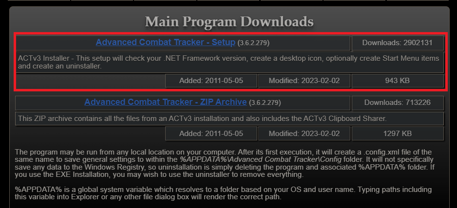
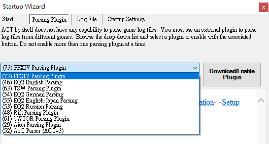
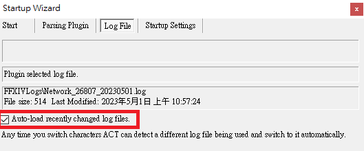
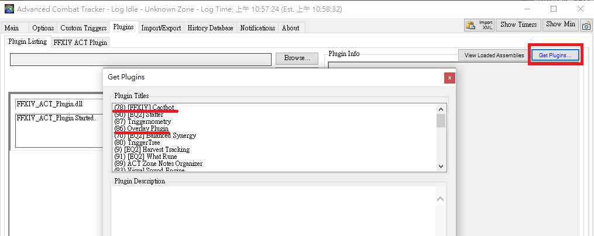
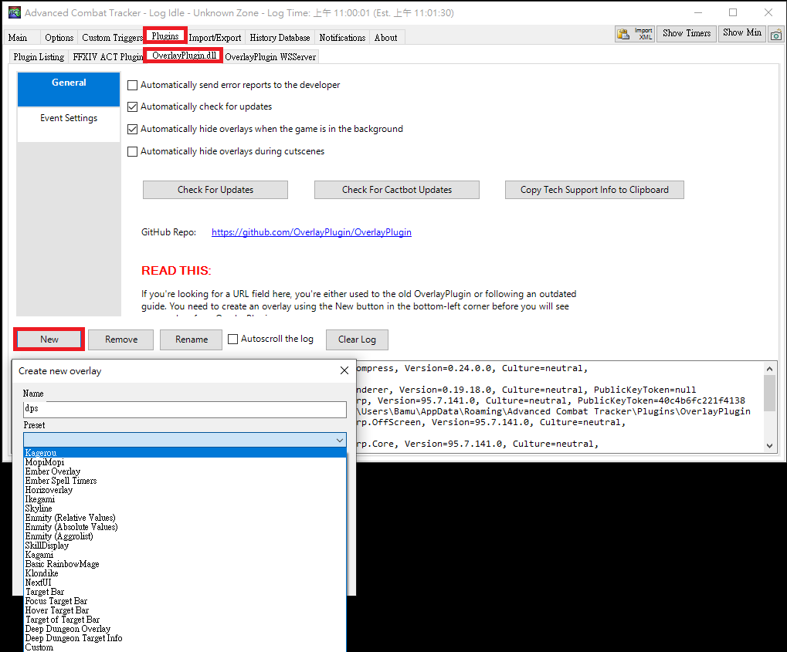
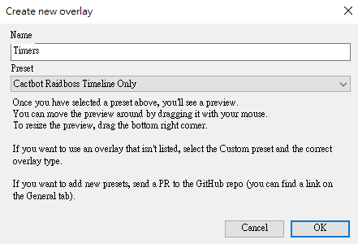
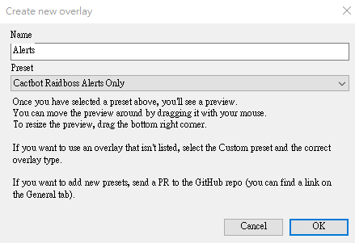
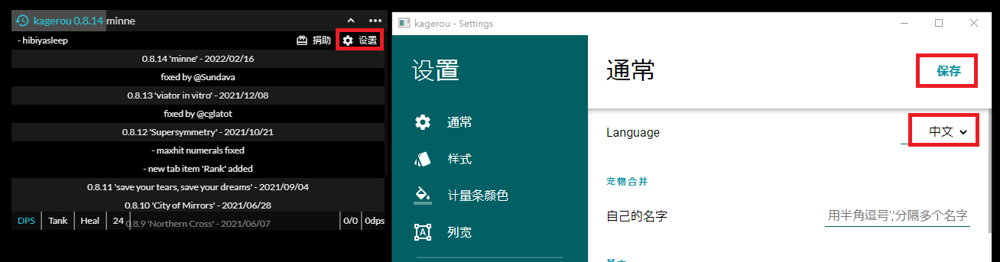

2023 04 29 created in Discord (FF14)
2026 10 25 move from Discord (FF14)

dps check

arcdps
https://advancedcombattracker.com/download.php

log
https://www.fflogs.com/

幫忙看自己的rotation哪裡有誤
https://xivanalysis.com/

created by bavo
```
arcdps 安裝教學影片
如下圖1，下載完後
把第一個裝在獨立資料夾 (也可裝在 FF14 裡，方便查看)
對 act 右鍵 > 內容 > 相容性 > 以系統管理員的身分開啟 > 套用
照圖片去安裝 Overlay + Catbot
把軟體關掉，重開 (Catbot 安裝完，重開才會生效)
把 dps + Catbot(Timers) + Catbot(Alerts) 設定出來，如圖2
把韓文調成中文，如圖3，完成 !
全部設定完成後，再次重開軟體
進遊戲會跳提示，加入防火牆例外清單，加完後，重開遊戲 & 軟體就OK
(或者主動去防火牆，把 act 加入例外清單)

一定要先開 act，再開遊戲才會生效唷 !
https://www.youtube.com/watch?v=kBqkcnKtJNU 

圖1，下載後，安裝到 FF14 資料夾 (安裝到哪都好，它是獨立的) 

圖2
1.記得右鍵內容，以管理員開啟
2.選第一個，按 Download

1.跳選項就按確定
2.記得把這個勾起來

1.先裝 Overlay Plugin，再裝 Catbot
2.裝完後，重開軟體

要新增三個 dps 插件，分別為
dps：普通的 acrdps
Catbot (timers)：顯示 boss 出招時機
Catbot (alerts)：顯示 boss 出招動作



圖3，韓文改成中文

```
