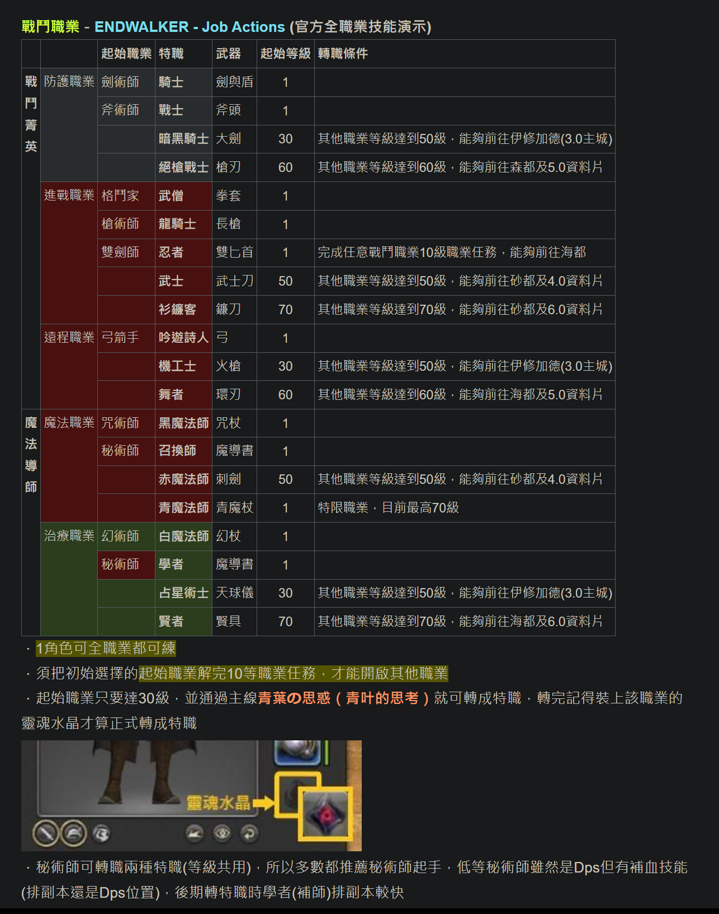
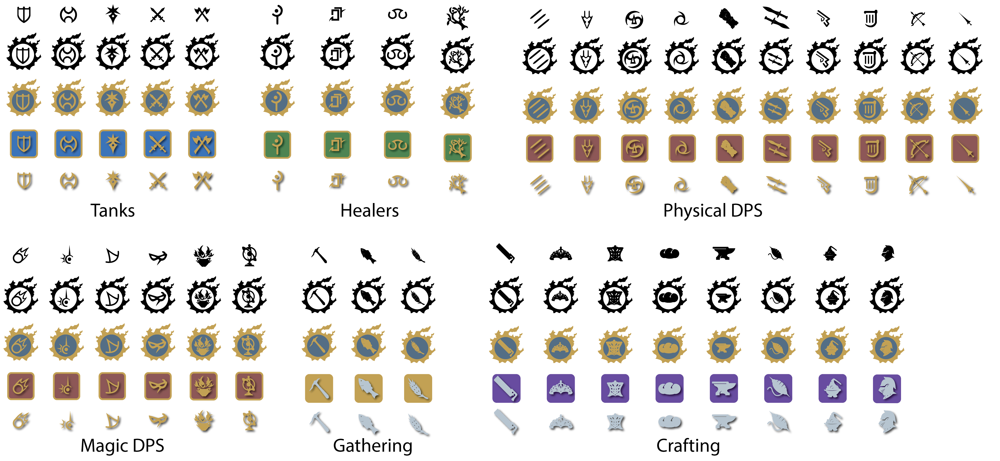

2023 04 20 created in Discord (FF14)
2026 10 25 move from Discord (FF14)

60級前職業任務道具可參考：
凡道具名前有註記 ^ 者皆為僅能繳交HQ品質的道具
https://docs.google.com/spreadsheets/u/0/d/1kQoytoh7aMZc_upQXe642SWXkpup1yiraJhWovIrv5s/edit?fromCopy=true 

各職業介紹
https://forum.gamer.com.tw/C.php?bsn=17608&snA=19247&tnum=4&bPage=4

輔助職業練等
https://forum.gamer.com.tw/C.php?bsn=17608&snA=17860&tnum=7&bPage=6

各職業簡短介紹
https://forum.gamer.com.tw/C.php?bsn=17608&snA=18973&to=6 

換職業方式?
兵裝庫 > 換武器 = 換職業

畫家 http://forum.gamer.com.tw/C.php?bsn=17608&snA=23535&tnum=5&bPage=2

4人副本基本上沒難度，跳過介紹。
大部份被定位做高難副本都是8人副本。
8人副本裡面默認配置是2Tank 2Healer 4DPS

Tank拆分為MT、ST(主副坦)
一般主坦負責拉位置、長時間扛boss
副坦比較多在死刑時換坦幫忙吃傷害  或者倒坦時補位等支援工作
某些副本也要幫忙拉小怪等等

Healer通常一個會是H1(白魔/占星)
另一個會是H2(學者/賢者)
並不是說一定要這樣分  只是這樣配置會比較輕鬆
H1的職業補血會比較輕鬆  但是上盾或團隊減傷較困難
H2則是相反，比較多負責減傷和給護盾

D1-D4
最理想的團隊必須會有至少1個近戰、物理遠程、法師
(會吃到團隊加成給更多能力值)
剩下一個可自由配置、但還是默認近戰
(因為4個近戰4個遠程   比較平均而且近戰通常傷害會比較高)

所以如果到外面去跟別人打東西
D1、D2為近戰、D3物理遠程、D4法師

這篇二樓
https://forum.gamer.com.tw/C.php?bsn=17608&snA=20383&tnum=5&bPage=3 

死刑(對坦的單體強傷害)  如果玩坦請用一些減傷去吃
有一些死刑會打1、2仇(主副坦)  也有一些是連續打兩次  需要換坦處理

看到所有眼睛  都請背對眼睛  例如2.0的第3個24人副本第1隻boss
有眼睛的時候  讀條結束前請背對
