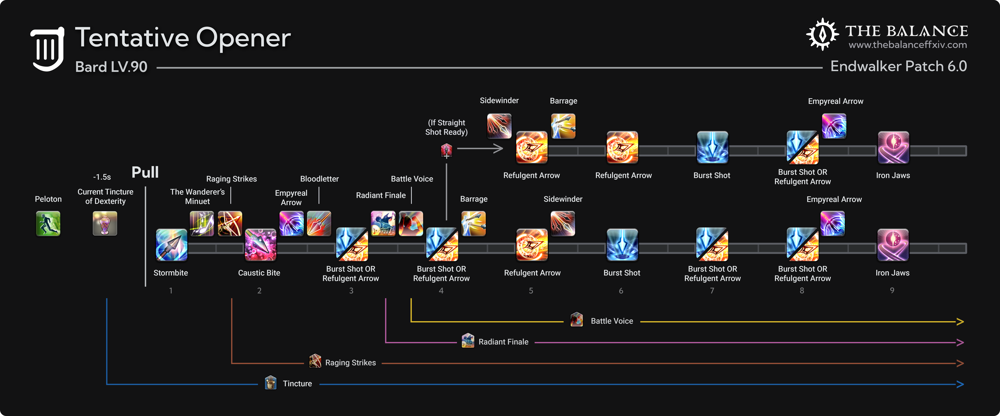

2023 04 21 created in Discord (FF14)
2023 05 03 update in Discord (FF14)
2026 10 25 move from Discord (FF14)

詩人 技能循環

來源 https://forum.gamer.com.tw/C.php?bsn=17608&snA=19464

旅神>賢人>軍神 分別剩 2秒 > 11秒 > 2秒

前20秒為爆發期；詩心滿3層再放；切歌前 ( 剩2秒 ) 不管幾層詩心都消耗掉再換歌
毒1 > 軍神+buff > 毒2 > 九天+斷魂 > 普攻 > 兩個buff > 普攻 > buff > 普攻or300箭 > 普攻x3 > 補毒

失血箭不要溢出；剩28秒時為戰鬥1分鐘；切歌前後 ( 剩11秒 ) 把失血箭層數消耗光
剩 30 秒 刷新毒

過渡期；失血箭存著不要亂打，除非要溢出了；Soul Gauge滿100還是存到旅神爆發
剩 30 秒 刷新毒

https://www.youtube.com/watch?v=QZm-0u8O2E8

