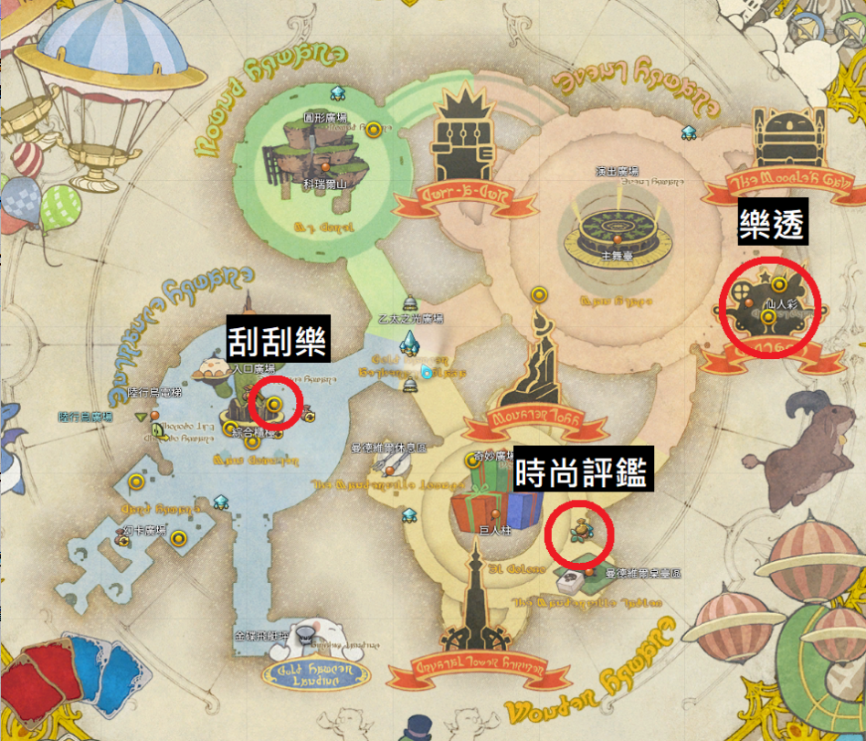

2023 04 19 created in Discord (FF14)
2026 10 25 move from Discord (FF14)
2026 10 27 moved from GOOGLE試算表 (FF14 副本 職業)

每日每周

## 每日 (台灣時間 每天晚上11:00刷新)
1.金蝶遊樂場 > 刮刮樂x3
2.軍團籌備任務 > 截圖
3.左轉進房間，冒險者小隊 派遣(18hr) or 訓練(1hr每天三次 總值滿了就不用練)
4.去市場旁邊，雇員探險 (2探險幣 18hr)
5.市場買 軍團籌備任務 物品 > 回軍團交任

6.隨機任務 練級副本 (給未滿50等的打) (大量經驗 / 軍票) 15min
7.隨機任務 主線任務 (經驗 / 詩學石x450) 20min
8.隨機任務 拾級任務 (經驗) 20min
8.隨機任務 討伐殲滅戰 (經驗) 5min
9.隨機任務 團隊任務 (經驗) 30min

10.蠻族每日x3任務x4蠻族 (角色>評價>點任一蠻族會顯示地點)



老顧主 - 不知道是什麼


## 每周 (台灣時間 每周二 下午4:00刷新)
1.仙人仙彩發放員 (樂透) 買三張
仙人彩 (橙色區域)，每周六 晚上 11:00 刷新，要手動領獎(下周刷新前領取，不然會消失)
2.時尚評鑑 (每周五 下午 4 點 ~ 每周二 下午 4 點)
按 最新 有解答 [這篇](https://forum.gamer.com.tw/C.php?bsn=17608&snA=20177&to=376)
金蝶遊樂場 黃區(多瑪方城戰往下跳) 時裝，直接給npc評鑑一次 = 1w 金蝶幣，喬好80分 = 6w 金蝶幣

3.天書奇談 (50%經驗 + 500詩學幣)
4.挑戰筆記
- 金蝶遊樂場 5 次G.A.T.E.事件 (XX：00 / 20 / 40各一次) 金蝶幣 13,000
- 金蝶遊樂場 3 次小遊戲 (陸行鳥廣場 往西走 > 礦脈探索 > 綠色的 贏了就退出) 金蝶幣 2,500
- 金蝶遊樂場 萌寵之王對戰 1/3/5 次 金蝶幣 5,000 / 10,000 / 12,000
```
只用 自走人偶001號(商店購買) 和 小牛犢(主線獲得)，不用小牛犢也沒差
開場 左右各3隻 人偶 分別去 敵左/右水晶。
中間造兩隻 小牛 派去 敵右後 防禦塔(紅色方形區域)，中間其餘全造 人偶，累積 4 隻一次派去中水晶
有就派去中水晶直到結束
```

其他項目
1.解主線
2.解各坦克職業主線
3.賭場小遊戲
4.練等 (目標 LV50 可以解各種每日刷新的隨機任務)
