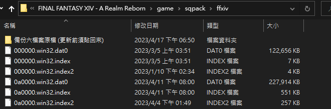
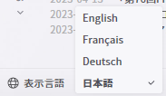

2023 04 18 created in Discord (FF14)
2025 04 08 update in Discord (FF14)
2026 10 26 moved from Discord (FF14)

漢化

created by bavo
```
注意：每次遊戲更新前，要把 "六個原檔" 貼回路徑裡 (2.)，更新完再把漢化檔案貼回去

漢化方式
下載一個字形 + 一個內容
Fonts_Gensen.rar + TW 6.38.0411.rar
https://drive.google.com/drive/folders/1kXFNQvzol8j9BTAsQ5k5Wz0jncben-uR

備份原檔：在桌面先解壓縮，在路徑下把這六個同檔名的原始檔複製進一個新資料夾裡
/SquareEnix/FINAL FANTASY XIV - A Realm Reborn/game/sqpack/ffxiv

把六個漢化檔案貼進去，取代原檔
開遊戲時，先在左下角選擇日文，進入遊戲後就漢化成功


```

新地點，尚未嘗試能不能用，下方有中文說明
https://github.com/GpointChen/FFXIVChnTextPatch-GP
