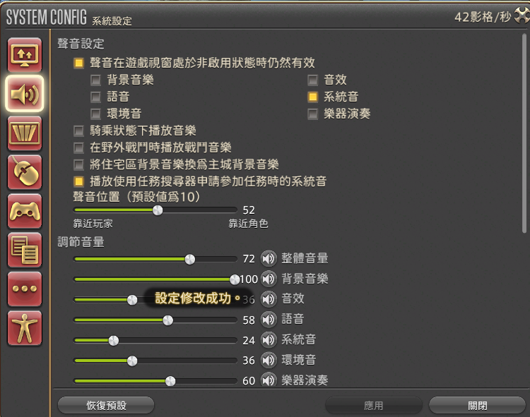
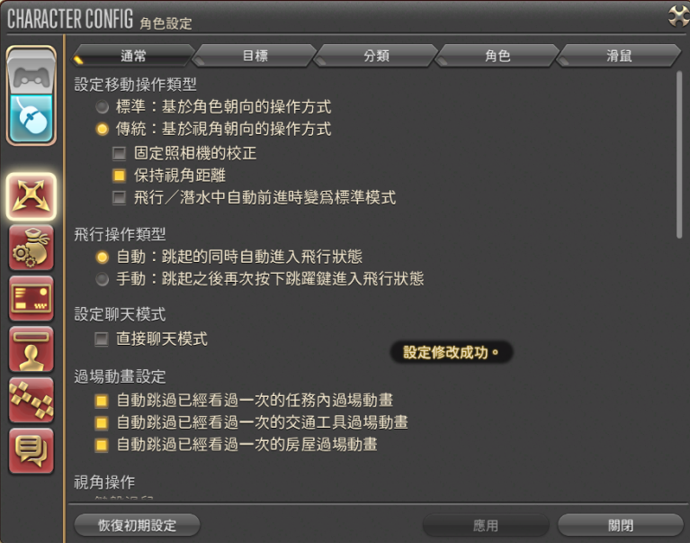

2025 04 09 created in Discord (FF14)
2026 10 26 moved from Discord (FF14)
2026 10 27 update

https://forum.gamer.com.tw/Co.php?bsn=17608&sn=72839&subbsn=10&bPage=2
滿等到畢業
滿等後，想直接挑戰高難副本，需要先了解自己職業的技能手法
過度：已足以通關最高難度副本，僅是容錯率比較低的差距
→購買拍買場該職業當前板子上最高裝分生產製作裝備(綠裝)
→當前版本極蠻神也會掉落部分部位(藍裝)
替換：
→了解自己職業BIS(Best in Slot)
→獲取周限制神典石，換取BIS部位裝備(藍裝)
畢業：※開始挑戰當前零式版本
→獲取零式裝備箱子(藍裝)
→獲取周限制神典石裝備提升道具
．武器除零式跟周限制神典石兌換以外，還有隨版本開放的紫武(發光武)可供畢業選擇

畢業後(除紫武以外)該裝備持續約兩個小版本，會有新版本的BIS裝備

→還有其他系統可以遊玩：滿等可以玩什麼?(此文9樓)
https://forum.gamer.com.tw/Co.php?bsn=17608&sn=73776&subbsn=10&bPage=0
滿等遊戲內容

排隊時，能在上網時聽到排好的音效

照著調就好

1	主線優先過完 超越幻想，究极神兵，才能參與活動
	主線任務WIKI
	
2	隨機副本 = 經驗多，每天各排一次 (最少要 練級、主線，其他有時間才打)
	
	戰士、白魔、召喚 是最推薦新人嘗試的三個職業 因為簡單又強

[術語解說](https://docs.google.com/spreadsheets/d/1up_KhAit6Lkr9uBEeT4N0S4vudOj-0UFWP5mgFRCVD0/edit?gid=682717712#gid=682717712)

詩學裝備 對應 裝備等級
| 資料片版本 | 起始 iLV | 最高 iLV |
| :---: | :---: | :---: |
| **2.x 重生之境** (A Realm Reborn) | 1 | 135 |
| **3.x 蒼天的伊修加德** (Heavensward) | 115 | 275 |
| **4.x 紅蓮的解放者** (Stormblood) | 260 | 405 |
| **5.x 暗影之逆焰** (Shadowbringers) | 390 | 535 |
| **6.x 曉月的終途** (Endwalker) | 530 | 665 |
| **7.x 黃金的遺產** (Dawntrail) | 710 | / |
