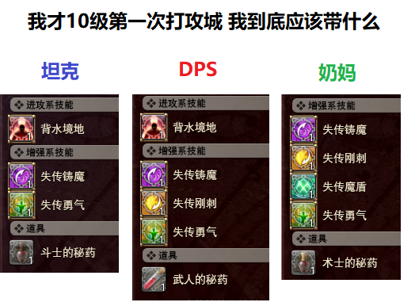
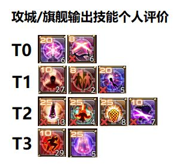
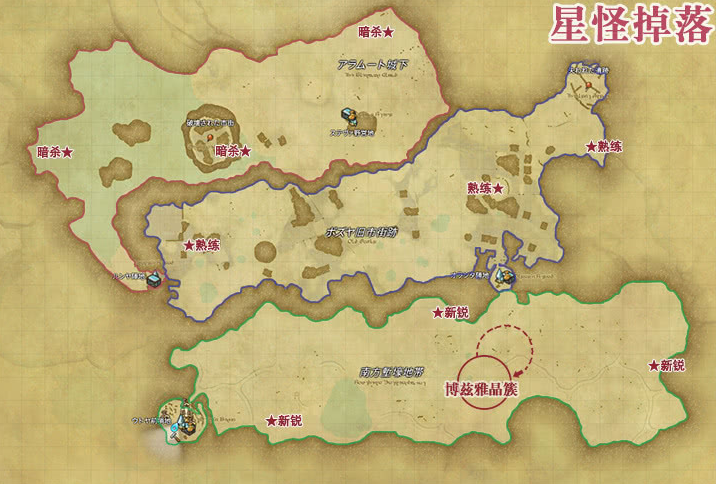
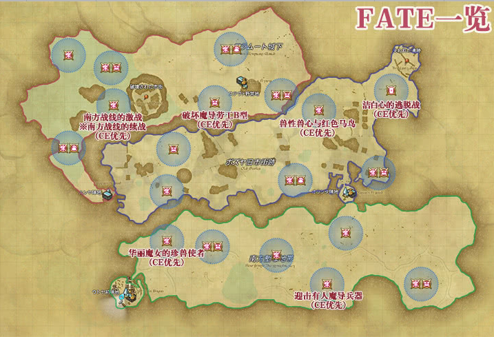
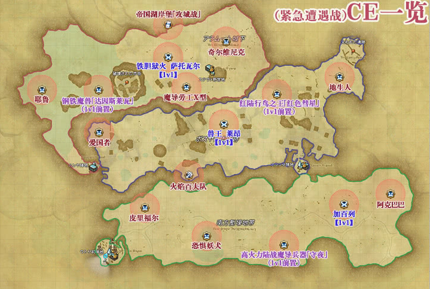
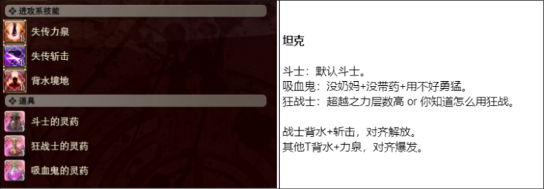
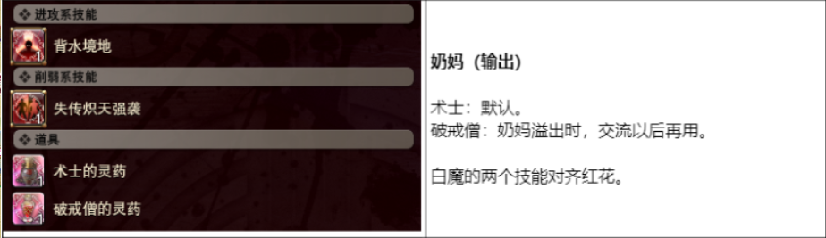
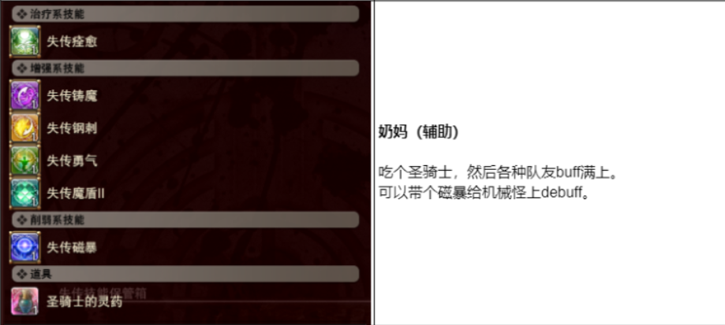
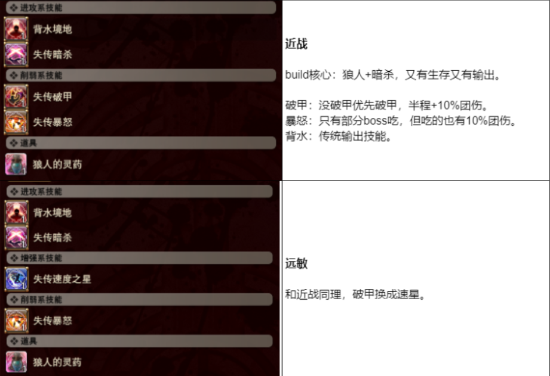
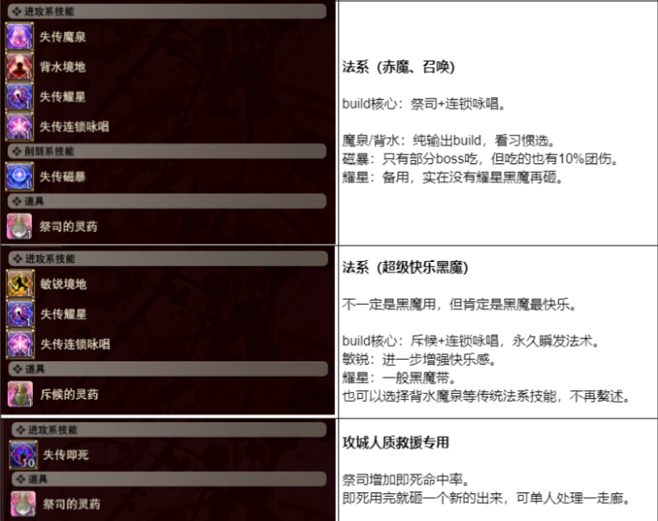

2025 04 created in GOOGLE試算表 (FF14 練等)
2026 10 27 moved from GOOGLE試算表 (FF14 練等)

天佑女王 的 南方博茲雅戰線 地圖 (博茲雅戰線)
目的
練等(71-100)
拿詩學裝備
發光武器

懶人包
狂解任務，技能+藥劑 = 大增傷

[技能藥劑 試算表](https://docs.google.com/spreadsheets/d/1VQ2ozTN-W-A3nxI1S2K8ocDPZXG5H2TLyq788cHXN3E/edit?gid=94281895#gid=94281895)

說明
[WIKI](https://ff14.huijiwiki.com/wiki/%E5%8D%97%E6%96%B9%E5%8D%9A%E5%85%B9%E9%9B%85%E6%88%98%E7%BA%BF)
[參考1](https://forum.gamer.com.tw/C.php?bsn=17608&snA=18112)
[參考2](https://home.gamer.com.tw/artwork.php?sn=5845864)

1.71等以上才能進來，不論裝備好壞，都會同步到 80 級 的狀態
2.解任務 & 打SM/CE，開啟 南方博茲雅戰線 地圖 為優先
3.有三張地圖 札杜諾爾高原、女王古殿、南方博茲雅戰線
參與SM CE，拿戰果。71-79拿經驗。80以上拿 詩學幣
4.副本中，死亡減少少量戰果、自行返回/退出副本 = 扣大量戰果。
拿戰果提升階級：5級開放二層地圖、8級開放三層地圖、10級開放工程戰
副本內容
- SM (Skirmish 衝突戰)
野外FATE，靠近就能直接打。
有經驗，有戰果(提升反抗軍等級 (推劇情 & 開地圖))
- CE (Critical Engagement 緊急遭遇戰)
打完指定SM or 人為觸發 後，透過 內建的博茲雅搜尋器 申請加入。
有經驗，有戰果(提升反抗軍等級 (推劇情 & 開地圖))
- 野怪
機械怪 掉 晶簇(可以換仙藥材料)、生物怪 掉 碎晶。
有經驗，"無"戰果
- 決鬥
部分CE打完後會觸發決鬥，一名玩家打一名敵人。透過 內建的博茲雅搜尋器 申請加入
所有決鬥前置的緊急遭遇戰都需要透過擊殺一定量機械怪來觸發，在依照觸發來決定決鬥者的大區，請先確認觸發者​​的意願
決鬥的難度較普通緊急遭遇戰高得多，且需要特定的失傳技能來應對特定技能如失傳堅壁、失傳驅魔等，因此最好做足相應準備。
獎勵：決鬥獲勝的玩家可獲得豐厚獎勵，同時決鬥場地附近的玩家也會獲得狀態士氣高漲60分鐘（增加100%的戰果獲取量）
勇氣值：報名決鬥落選後會提升1點勇氣值，勇氣值越高被選入決鬥的優先順序也越高，成功進入任一決鬥後會清空勇氣值。

4.義軍等級達到10 才開放的副本 (三張地圖各一個)
- [帝國湖岸堡攻城戰 (戰線)(80級 2-48人副本)](https://ff14.huijiwiki.com/wiki/%E5%B8%9D%E5%9B%BD%E6%B9%96%E5%B2%B8%E5%A0%A1%E6%94%BB%E5%9F%8E%E6%88%98)
透過 內建的博茲雅搜尋器 申請加入
"觸發條件：區域內至少有兩名符合參加條件的玩家，且離上次大規模決戰結束或當前副本區域開放經過60分鐘
完成 SM/CE/決鬥 會縮短下次攻城戰的觸發時間(1/6/6分鐘)，最多縮短至30分鐘
- [旗艦達爾里阿達號攻略戰 (船戰)(80級 2-48人副本)](https://ff14.huijiwiki.com/wiki/%E6%97%97%E8%88%B0%E8%BE%BE%E5%B0%94%E9%87%8C%E9%98%BF%E8%BE%BE%E5%8F%B7%E6%94%BB%E7%95%A5%E6%88%98)
同上
- [女王古殿 (有零式)(80級 24人副本)](https://ff14.huijiwiki.com/wiki/%E5%A5%B3%E7%8E%8B%E5%8F%A4%E6%AE%BF)
喝仙藥+失傳技能組合打法最主流。

5.超越之力
在（決鬥除外）的緊急遭遇戰中，當參與人數過少時會被附加超越之力，
對應關係為1人——300%，2-3人——200%，4-5人——75%，6-7人——30%，8人及以上無超越之力，且敵人血量會成比例增加。
在大規模決戰中，當參與人數過少時會被附加超越之力，
對應關係為1-5人——300%，6-8人——220%，9-11人——200%，12-16人——75%，17-23人——30%，
24人及以上​​無量超越之力，且敵人增加血量會成比例增加。
超越之力和敵人血量在任務開始的一刻就已經固定，不會隨後續的人數減少而改變。

6.[失傳技能](https://ff14.huijiwiki.com/wiki/%E5%A4%B1%E4%BC%A0%E6%8A%80%E8%83%BD) (最多能同時使用 技能x2 & 藥劑x2)
失傳敏捷Lost Swift：全面加速，跑圖神技。
Reraiser：死亡復活道具，打高難戰鬥保命。
Support系：增傷Buff、偷取敵人Buff、法術反彈。
Tenacity碎晶：便宜量大，兌換30%血量Buff。
地雷偵測技能：特定副本必備（女王副本用）。
補充：碎晶與藥劑可交易，有經濟價值，部分藥劑例如偷取Buff超搶手。
龍騎的lost搭配
穿博茲雅495加速裝配耳環，配上狂亂(物理型範圍技)+爆菊(暗殺技，配狼人藥會有力泉效果)+狼人藥就可以在博茲雅裡橫著走
狂亂(16級碎晶-獰猛)、爆菊(18級碎晶-美技)、狼人藥(11級碎晶-信仰)
部分技能or藥劑有隱藏效果

術士的秘藥(治療職能限定,強化技能碎晶)傷害+80%
鬥士的秘藥(坦克職業限定,強化技能碎晶) 傷害+60%
魔戰士的秘藥(法師及治療職業限定,強化技能碎晶) 物防+150%魔防+45% 最大HP+60%
重騎兵的秘藥(物理輸出職業限定,強化技能碎晶) 防禦力+80%最大HP+45%
坦克-鬥士的秘藥(60%增傷),鬥士的靈藥(72%增傷)
自信的奶媽-術士的秘藥(80%增傷),術士的靈藥(96%增傷)
不太自信的奶媽-聖騎士的秘藥(60%增傷),聖騎士的靈藥(72%增傷),聖騎士的增傷弱一點,不過會增加體力/防禦力。
DPS-武人的秘藥(20%增傷、15%暴擊),武人的靈藥(24%增傷、18%暴擊)
斥候+敏銳+狂吃AOE：+20%詠速/技速；盜賊+以太藥箱：無限絕望
祭司藥+失傳連鎖詠唱：30秒時間內，100%魔法增傷，所有法術變成瞬發。 90秒CD。除了黑魔以外的法系和奶媽可用此build。 (黑魔不能吃祭司藥)
狼人藥+失傳暗殺：永續力泉，30%增傷+40%暴擊。所有物理系DPS可用此build。
推薦 白魔(破戒僧的靈藥(傷害+120%) + 失傳熾天強襲(高攻/增傷/位移 CD60s) + 磁暴or連鎖詠唱
術士秘藥(增傷80%)

7.獲得物品
水晶 兌換地圖（移動加速）、失傳道具。
碎晶 掉落失傳技能和藥劑來源，分為黃、綠、白三種。
錢幣 用於兌換裝備（銅、銀、金、白銀、秘銀）。
- 銅幣 南方掉落，兌換495裝備與升級道具。
- 銀/金幣 女王副本與周任務給，兌換510裝備。
- 秘銀/白銀幣 高地掉落與周任務產出，用途不大。

8.義軍武器升級流程概覽（5階段）
485起始武器 用1000詩學兌換。(到魔杜納用1000詩學換取 薩維奈靈鱗粉 ×4（250 詩學/個）之後每一把：只需提供 4 個靈鱗粉即可交換
500武器  需黃藍紅記憶各20（刷南方最快）。跟500發光同時接，一起刷
500發光武器 需6綠記憶（副本或南方野怪掉落） (險峻峽谷 塞爾法特爾溪谷、星海空間 顛倒塔)
510非發光武器 需15白水晶（南方攻城戰/遭遇戰掉落）。
515發光武器 跑女王本5次。
535最終武器 需15藍水晶（70等副本、女王本或高地攻城戰給）。

[資料來源](https://no-gorilla.net/mettle/)
| RR | 南方戰壕地帶 SM | 南方戰壕地帶 CE | 博茲雅舊街道遺跡 SM | 博茲雅舊街道遺跡 CE | 阿拉吉城下町 SM | 阿拉吉城下町 CE |
|:---:|---:|---:|---:|---:|---:|---:|
| 1 | 100 | 250 | － | － | － | － |
| 2 | 150 | 375 | － | － | － | － |
| 3 | 200 | 500 | － | － | － | － |
| 4 | 250 | 625 | － | － | － | － |
| 5 | 300 | 750 | 540 | 1,350 | － | － |
| 6 | 350 | 875 | 630 | 1,575 | － | － |
| 7 | 400 | 1,000 | 720 | 1,800 | － | － |
| 8 | 450 | 1,125 | 810 | 2,025 | 1,170 | 2,925 |
| 9 | 500 | 1,250 | 900 | 2,250 | 1,300 | 3,250 |
| 10 | 550 | 1,375 | 990 | 2,475 | 1,430 | 3,575 |
| 11 | 750 | 1,875 | 1,350 | 3,375 | 1,950 | 4,875 |
| 12 | 1,100 | 2,750 | 1,980 | 4,950 | 2,860 | 7,150 |
| 13 | 1,600 | 4,000 | 2,880 | 7,200 | 4,160 | 10,400 |
| 14 | 2,400 | 6,000 | 4,320 | 10,800 | 6,240 | 15,600 |
| 15 | 2,500 | 6,250 | 4,500 | 11,250 | 6,500 | 16,250 |

| RR | NEXT（累計） | NEXT（差分） |
|:---:|---:|---:|
| 1 | 300 | 300 |
| 2 | 1,100 | 800 |
| 3 | 2,200 | 1,100 |
| 4 | 3,800 | 1,600 |
| 5 | 9,400 | 5,600 |
| 6 | 18,000 | 8,600 |
| 7 | 32,000 | 14,000 |
| 8 | 51,300 | 19,300 |
| 9 | 78,000 | 26,700 |
| 10 | 106,900 | 28,900 |
| 11 | 157,400 | 50,500 |
| 12 | 252,000 | 94,600 |
| 13 | 416,000 | 164,000 |
| 14 | 703,200 | 287,200 |
| 15 | － | － |

[來源](https://www.ffxiv.cn/detail/article/564)

