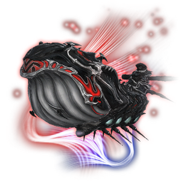
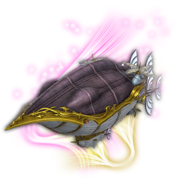
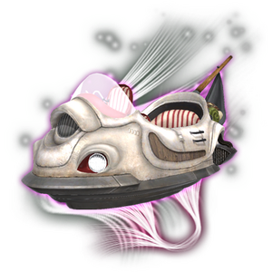
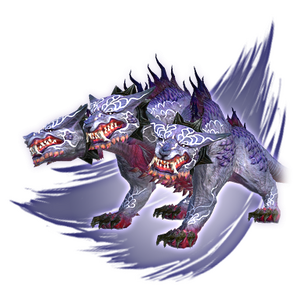
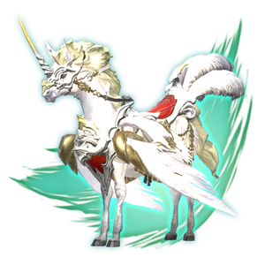
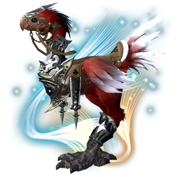
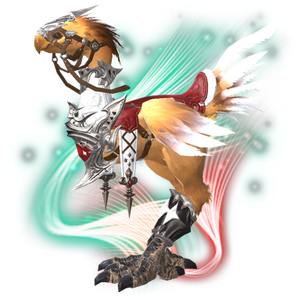
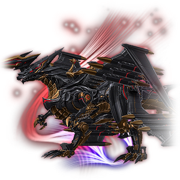

2023 04 25 created in Discord (FF14)
2026 10 25 move from Discord (FF14)

坐騎/騎寵一覽
[試算表](https://docs.google.com/spreadsheets/d/1ahHUx036V6wj75-Z3ZB0PXqH9Amg27yZszP3jIwLjGs/edit?gid=516031448#gid=516031448)

# FF14 坐騎整理 

| 坐騎名稱 | 乘坐人數 | 移動方式 | 取得方式 | 圖片 |
|---|:---:|:---:|---|---|
| Lunar Whale 真月魔導鯨 | 8 | 飛行 | 課金 |  |
| Blackjack 黑傑克號 | 4 | 飛行 | 4,000,000 MGP |  |
| Skyslipper 氣墊船 | 4 | 飛行 | 伊甸園零式希望樂園覺醒之章 4 |  |
| Air-wheeler C9 | 4 | 陸地 | AAC Cruiserweight M4 (Savage) |  |
| Cerberus 刻耳柏洛斯 | 4 | 陸地 | 成就：戰鬥－特殊場景探索 完全稱霸女王古殿 1 （成功挑戰零式女王古殿） |  |
| Al-iklil 王冠號 | 2 | 飛行 | 成就：探索－複製任務 博茲雅的記錄員 達成「南方博茲雅戰線的記錄員」、「女王古殿的記錄員」、「扎杜諾爾高原的記錄員」三個成就 |  |
| Astrope 天陽馬阿斯特洛珀 | 2 | 陸地 | 成就：角色－整體 可靠的前輩 6 參加並完成累積 2,000 次隨機任務：指導者任務 |  |
| Amber Draught Chocobo 紅大陸行鳥 | 2 | 陸地 | 黃金陸行鳥的羽毛 × 8 或成就幣 × 40 |  |
| Draught Chocobo 大陸行鳥 | 2 | 陸地 | 招募好友活動 好友訂閱 90 天後，招募者獲得獎勵 |  |
| Garlond GL-IIT 加隆德 GL-IIT | 2 | 陸地 | 100,000 無人島藍幣 （無人島需 20 級） |  |
| Landerwaffe 黑鋼機龍連達巴非 | 2 | 陸地 | 打極神討伐戰取得七個指定坐騎後，完成指定任務獲得 |  |
