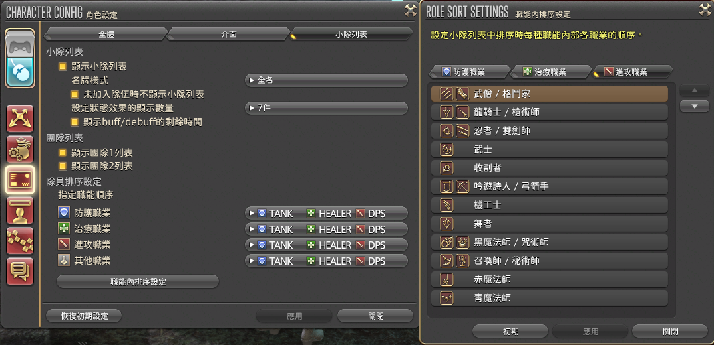

2023 04 23 created in Discord (FF14)
2026 10 25 move from Discord (FF14)
2026 10 27 moved from GOOGLE試算表 (FF14 故事 地圖)
2026 10 27 update

巨集 占星術士 自動發牌

占星術士 - 自動發牌 (發給近程dps / 發給遠程dps)
資料來源 這篇 15樓 https://forum.gamer.com.tw/C.php?bsn=17608&snA=19488 

1.指定二號隊友 (micon用滑鼠點"巨集名"左側圖標 可以選擇 防護職業2)
/target <2>

2.占星出牌II III 給指定的人 (坦克)
/merror off
/ac 出卡II <t>
/ac 出卡III <t>
/micon "出卡III"

3.占星出牌I 紅的給近戰 (隊伍的 第 3 人，必定為 近程dps)
/merror off
/ac 出卡I <5>
/ac 出卡I <3>
/micon "出卡I"

4.占星出牌I 藍的給遠程 (隊伍的第 8 / 4 人，必定為 近程dps)
/merror off
/ac Play  <8>
/ac Play  <4>
/micon "出卡I"

5.角色設定 > 介面設定 > 小隊列表 > 職能內排序設定 > 進攻職業
(1~6排進戰dps由高至低排、10~13排遠程dps優低至高排，這樣保證給的是dps最高的職能)
(四人副本可能排到兩個遠程dps，這時候只能手動選擇坦克 手動給紅色buff)
近戰 DPS
1.忍者／雙劍士
2.奪魂者
3.武僧／格鬥士
4.龍騎士／槍術士
5.武士
6.毒蛇劍士

遠程物理 DPS
7.舞者
8.吟遊詩人／弓術士
9.機工士

遠程魔法 DPS
10.召喚士／巴術士
11.赤魔道士
12.黑魔道士／咒術士
13.繪靈法師

