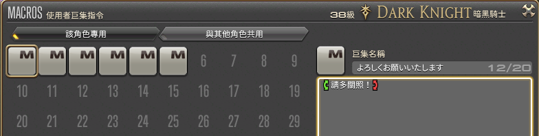

2023 04 22 created in Discord (FF14)
2026 10 25 move from Discord (FF14)

巨集 定型文

created by bavo
```
定型文 wiki
https://ff14.huijiwiki.com/wiki/定型文翻译系统

官方內建的 統一招呼語 (跨語言)

使用方法
在對話欄 tab 就能選擇

招呼語
請多關照
謝謝你
打得好 ! 辛苦了 !

動作 ( /動作 tab 就能選取 動作的定型文)
歡迎
高興
跳舞

把 定型文 設定在 熱鍵上
打開 使用者巨集 (如圖)

```
