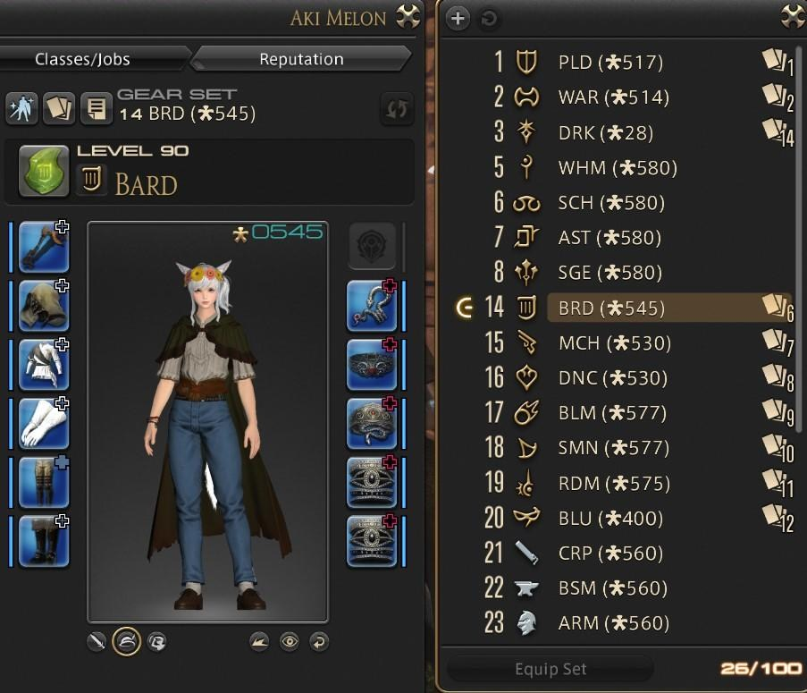
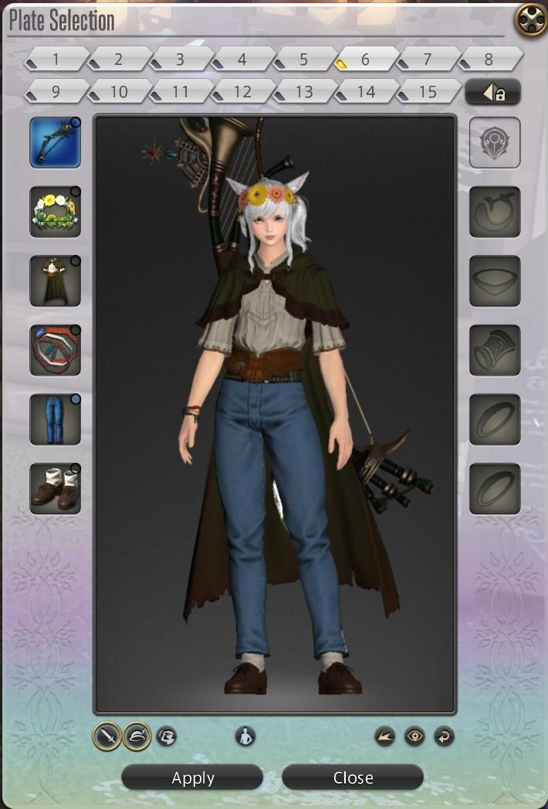
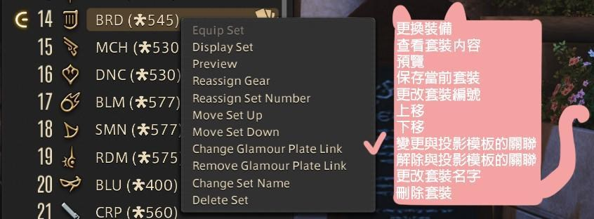

2023 04 22 created in Discord (FF14)
2026 10 25 move from Discord (FF14)

巨集 換裝時 自動幻化裝備

created by bavo
```
方法1
/gearset change (這是套裝列表所在的位置)  (這是投影模板的數字)

例如 /gearset change 14 6
就可以每次變更職業時自動投影了（前提是所處的地方可以投影）

方法2
對第 14 個右鍵 "變更與投影模板的關聯" (把套裝14 和 外觀6 綁一起)，就可以省略後面的 6 了
/gearset change 14



```
