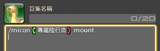
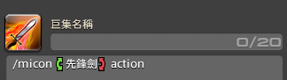
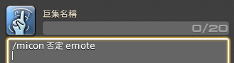
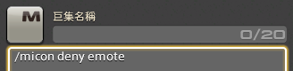
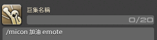
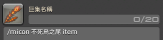
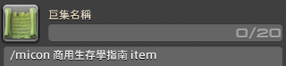
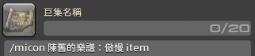

2023 04 22 created in Discord (FF14)
2026 10 25 move from Discord (FF14)

巨集 改變圖標

改變圖標 code (打在巨集 指令第一行 enter 生效 )
/micon 動作 emote (icon 直接打繁體動作就好，若要動作類定型文 /動作 tab 就會有選項了)
/micon 戰鬥技能 action
/micon 寵物 minion
/micon 職業 classjob
以此類推，細分放在下方

圖標吃語言 (巨集介面 右下角 有 "文字指令一覽")
定型文：通通有效
美版：英文有效
日版：日文有效
中文版：中文有效

但是 !! 如果 物品/表情/動作 本身沒有定型文，就直接打中文吧 ! 

怎麼找 有圖標的動作
右下角 > 社群 > 情感動作

https://forum.gamer.com.tw/C.php?bsn=17608&snA=19488
技能 (action)
青魔法技能 (blueaction)
對戰技能 (pvpaction)
共通技能 (general)
情感動作 (emote)
companion
召喚獸 (pet)
寵物 (minion)
坐騎 (mount)
道具 (item)
enemysign
場景标記 (waymark)
套裝 (gearset)
職業 (classjob)
快捷發言 (quickchat) 

