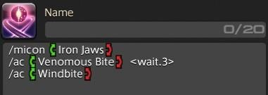

2023 04 22 created in Discord (FF14)
2026 10 25 move from Discord (FF14)

created by bavo
```
巴哈 11 樓
https://forum.gamer.com.tw/C.php?bsn=17608&snA=19488

建議使用方法3

方法1 基礎法
/micon (技能)
/ac (技能) <wait.3>
/ac (技能)

方法2 技能施放為 123 loop，原地改格子
缺點：按太快按鍵會吃掉連擊，改善方法 加上 wait 1/2/3
要占用三欄熱鍵欄

/micon (技能)
/ac (技能)
/hotbar copy mch 9 mch 3

技能1
/micon Heated Split Shot
/ac Heated Split Shot
/hotbar copy mch 9 mch 3

技能2
/micon Heated Slug Shot
/ac Heated Slug Shot
/hotbar copy mch 10 mch 3

技能3
/micon Heated Clean Shot
/ac Heated Clean Shot
/hotbar copy mch 8 mch 3

方法3 按下去會自動把 "第一個技能 變到 第三號熱鍵欄的第一個位置"，過兩秒後那個位置會變成下一個連擊技能
優點 可以連擊，也只吃一個鍵位 (方法2 吃三個)
/micon (技能)
/hotbar set (技能)  3 1 <wait.2> 
/hotbar set (技能)  3 1 <wait.2>
/hotbar set (技能)  3 1 <wait.2>
/hotbar copy mch 7 mch 3

黑暗騎士 重斬 loop (放在 第一欄 第一個技能，結束後複製 欄4 到 欄1)
/micon 重斬 action
/hotbar set 重斬  1 1 <wait.2>
/hotbar set 吸收斬  1 1 <wait.2>
/hotbar set 噬魂斬 1 1 <wait.2>
/hotbar copy drk 4 drk 1
```
