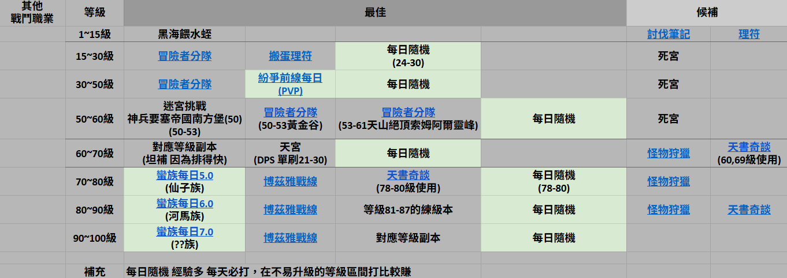
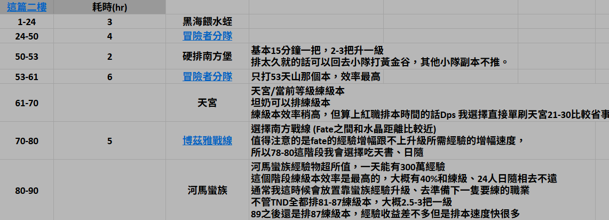

2023 04 24 created in Discord (FF14)
2025 04 created in GOOGLE試算表 (FF14 練等)
2026 10 25 move from Discord (FF14)
2026 10 27 moved from GOOGLE試算表 (FF14 練等)

戰鬥職業 練等

[懶人包](https://docs.google.com/spreadsheets/d/1VQ2ozTN-W-A3nxI1S2K8ocDPZXG5H2TLyq788cHXN3E/edit?gid=862308852#gid=862308852)

1 ~ 50 等最慢。50 以後，只打每日就能快速升等

優先 (有資料片才能用)
1 ~ 30 使用 ⁠生態系練法 ，1 ~ 1.5 hr，非常有效率

1 ~ 16 職業任務 + 死宮 補等級 (dps直接做 討伐筆記 即可)
搬蛋 理符任務 https://www.youtube.com/watch?v=5BMYhKODfwc

16 ~ 50 leveling + PVP(30up) + (指定副本 + 死宮 + 冒險者小隊)

leveling + PVP 為主，後面的三個 趕進度用
PVP > 一場 升 3 ~ 4 等 軍階 9 階 開啟 紛爭前線
指定副本 > 1 ~ 30 等 1 場 2 ~ 3 級 / 31 ~ 40 等 1 場 1 級 / 40 等 up 1.5 場 2 級
死宮 > 1 ~ 30 等 1 場 2 ~ 3 級 / 31 ~ 40 等 2 場 1 級 / 41 ~ 50 等 2.5 場 1 級 /  51 ~ 60  4 場 1 等
冒險者小隊 > 跟 npc 打副本，節省排隊時間 (前置：到達Lv.47 & 完成自己加盟的陣營的討伐筆記)

50 ~ 80 leveling + 一堆每日 (經驗大量溢出)

一堆每日 > 討伐 (LV50/4人) 5min + 主線 (LV50/4人) 30min + 水晶塔 (LV50/24人) 30min + 每日蠻族任務
每日蠻族任務 > 51 ~ 60 ??族 / 61 ~ 70 烏龜族 + 蛇族 / 71 ~ 80 妖精族

61 ~ 70 天宮 4 場 1 等 (如果 10 分鐘一場，會比打副本還快)

71 ~ 80 親信小隊(可以順便練親信小隊的等級) / 南方戰線

補充
1.可跳過：機工城(LV60/8人)(經驗普通)、大型(經驗少)、行會令(什麼都少)

2.全部只要練一個角色就好
3.因為遊戲內功能綁主線，主線又臭又長
4.角色 外觀/性別/種族 可以用 外觀藥 更改
5.集中一隻把等級推高 for 主線，避免卡主線 卡功能，最高等級角色溢出的經驗不用管，這遊戲每日給的經驗量很多，所以以開功能為主

3.*若遇到差一點點可以打新的副本時就去死者的宮殿打一場，達到下個副本的等級要求後，再去排下一個副本
坦、補的話這樣練比較快*

4.*主線 抽到的關卡越長 經驗越多
外郭 - 26min -經驗45%
魔導城 - 50min - 經驗75%*

5.*50/60/70/80主線 > 拿 詩學石 專用 (經驗少)
90 為賺石頭 > 拿 石頭(90等裝備)*

6.經驗多寡：主線任務 > 72PvP > 練級 > 團隊 > (90級 > 50 / 60 / 70/ 80 級) > 討伐 > 大型 > 行會令

https://forum.gamer.com.tw/C.php?bsn=17608&snA=20110

每周 (點每日會順便解完的東西)
1.天書 - 不論等級 拿 50% 經驗
按 I > 任務道具及水晶 > 庫洛的奇談書 > 右鍵 > 使用 可開啟
每週二刷新

2.挑戰筆記 - 一些經驗/一些錢
每天排每日，會順手解掉一些，效益不清楚
右下角 > 手冊管理 > 挑戰筆記
每週二刷新
