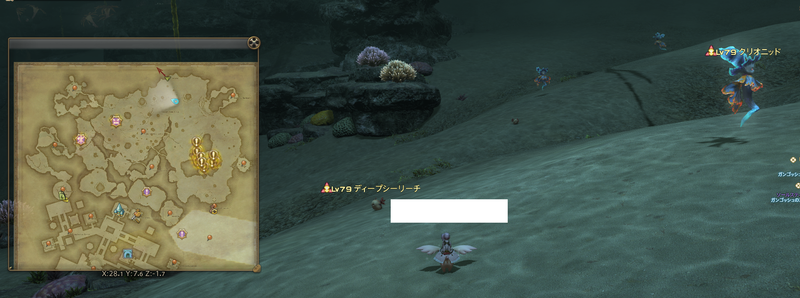

2023 04 22 created in Discord (FF14)
2026 10 25 move from Discord (FF14)
2026 10 27 moved from GOOGLE試算表 (FF14 練等)

生態系練法

## 目的
1 ~ 30 等 > 1 ~ 1.5 hr

## 前置
已開啟 5.0地圖 黑風海(テンペスト)
經驗加成：部隊特效(15%)、任意食物(3%)、初學者指環(30級以下30%)(完成 初學者學堂 任務「最終訓練」後獲得)

不用朋友幫忙上盾練法 https://www.youtube.com/watch?v=MqZe28pnmyU

一個高等 & 可上盾的朋友
不要組隊

## 流程
朋友幫自己上盾
我摸小怪一下 (必定要自己開怪，才會有經驗)
把小怪拖到 藍色怪 旁邊，藍色怪 會 吃掉小怪 > 自己獲得經驗值

每隻藍色怪，只能吃兩隻小怪，不然吃到第三隻，藍色怪 會變得超巨大，一掌把人拍死！
先上完盾，才摸小怪，避免把仇恨吸走

https://home.gamer.com.tw/artwork.php?sn=4903642 

## 另一個解說
1.直接上坐騎靠近水蛭臉開之後磕一瓶最便宜的恢復藥就能拉到仇恨
2.把 水蛭 帶到 天使 旁邊餵掉就行了

熟練之後可以一次性餵2-3個，不需要找人給上盾
隻冰海天使最多餵2只就必須換目標，如果餵到3只會巨大化

[資料來源](https://nga.178.com/read.php?tid=33710279&rand=344)
