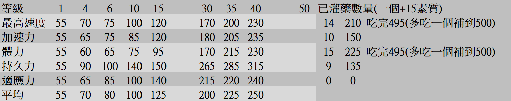
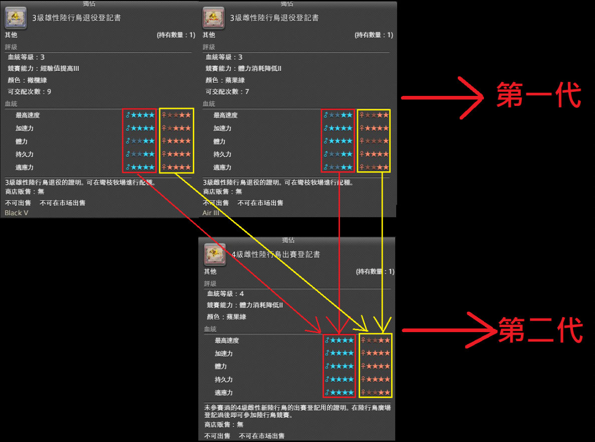

2023 04 28 created in Discord (FF14)
2026 10 25 moved from Discord (FF14)
2025 04 created in GOOGLE試算表 (FF14 副本 職業)
2026 10 27 moved from GOOGLE試算表 (FF14 副本 職業)

[其他資料](https://forum.gamer.com.tw/C.php?bsn=17608&snA=17342)

配種地點： "黑衣森林中央林區 彎枝牧場" > "大水晶左手邊商人(凱特瑞)"

規則
R1+R1 > R2
R2+R2 > R3
以此類推
R8+R8 > R9
R9+R9 > R9

練到LV40 即可"退役" > "配種"
到R7前 "退役"+商店買的 > R8
(R7後再來配技能)

R8之後也可以用 商店買的 來配種
or
自己練兩隻R8來配種："退役"+"退役" > R9

| 等級 | 1 | 4 | 6 | 10 | 15 | 30 | 35 | 40 | 50 | 已灌藥數量（一個 +15 素質） | 灌藥總素質 | |
| --- | ---: | ---: | ---: | ---: | ---: | ---: | ---: | ---: | ---: | ---: | ---: | ---: |
| 最高速度 | 55 | 70 | 75 | 100 | 120 | 170 | 200 | 230 | — | 14 | 210 | 吃完495(多吃一個補到500) |
| 加速力 | 55 | 65 | 75 | 85 | 120 | 180 | 205 | 235 | — | 10 | 150 | |
| 體力 | 55 | 60 | 65 | 75 | 95 | 170 | 215 | 230 | — | 15 | 225 | 吃完495(多吃一個補到500) |
| 持久力 | 55 | 90 | 100 | 140 | 150 | 265 | 285 | 315 | — | 9 | 135 | |
| 適應力 | 55 | 65 | 85 | 100 | 140 | 215 | 220 | 240 | — | 0 | 0 | |
| 平均 | 55 | 70 | 80 | 100 | 125 | 200 | 225 | 250 | — | — | — | |

最終目的 R9 "滿素質" & "特定技能"*2
(体力消耗軽減III & 超級加速or重力耐性V)
詳見 遊戲資料>FF14>陸行鳥競賽 配種教學
配種地點： "黑衣森林中央林區 彎枝牧場" > "大水晶左手邊商人(凱特瑞)"

每場 500硬幣，每輪 3min (含進出)。1萬/hr

