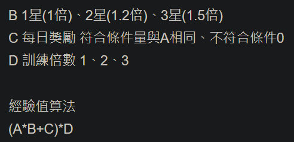
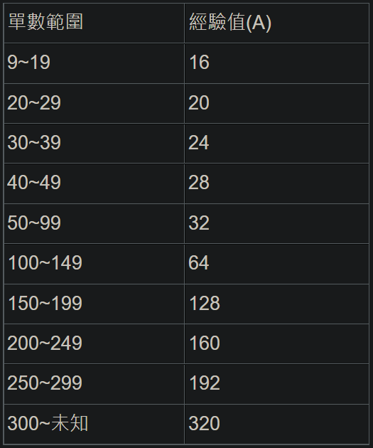
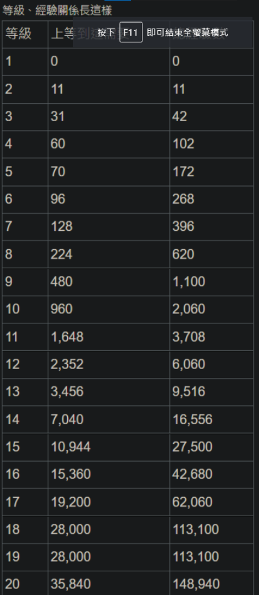

2021 12 28 created in Discord (其他遊戲)
2022 01 10 update in Discord (其他遊戲)
2026 10 26 moved from Disord (其他遊戲)

練等相關

資料來源(看完資料後，自己整理成以下結論&說明)
https://forum.gamer.com.tw/C.php?bsn=38726&snA=157&tnum=3

結論：
主線衝到300關 就能用 最少體 拿 最多經驗！

寶可夢升等
1>5         吃一次點心(小)
6>10      打工 1 次(3體 1星)
11>15     打工 11次(3體 3星)

拿手料理
等級到3、5、15會各解放一個

解放等級上限
卡 5等   > 花3餅乾   + 500金橡果
卡 10等 > 花10餅乾 + 1000金橡果
卡 15等 > 花10餅乾  + 1800金橡果 
活動寶可夢 吃東西不會獲得餅乾 (只能從活動拿) 

補充資料
打工經驗公式

打工經驗試算
寶可夢等級/經驗
1>5         172        (吃一次小點心)
6>10      1888     (打工 1 次(3體 1星))
11>15     25440 (打工 11次(3體 3星))
16>20   121440 (打工51次(3體 3星))
單數300、訓練3星、有每日獎勵、3倍體
(320x1.5 + 320) x 3 = 2400

單數300、訓練1星、有每日獎勵、3倍體
(320x1.0 + 320) x 3 = 1920

單數300、訓練3星、有每日獎勵、2倍體
(320x1.5 + 320) x 2 = 1600 (8等快一半，才能用這個一次升滿)

單數250、訓練3星、有每日獎勵、3倍體
(192x1.5 + 192) x 3 = 1440

小點心經驗200、大點心經驗1000

結論： 主線衝到300關 就能用最少體拿最多經驗！ 

等級對應經驗

補充
訓練 "每一場" "3星" 拿30點活動點數!

有些服裝會改變寶可夢的拿手料理!
不過訓練是看 "原本的拿手料理" 來算"每日獎勵"!
(ex: "暖暖披肩六尾" 拿手料理是 "點心"，"原本的拿手料理" 是 "咖啡"。
使用 "暖暖披肩六尾" 在 "點心" 加倍天訓練，無法獲得每日獎勵加成!) 
