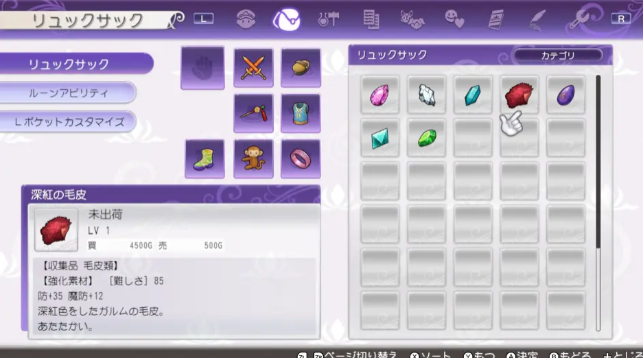

2023 11 01 created in Discord (其他遊戲)
2026 10 26 moved from Discord (其他遊戲)

解全異常狀態魔法

水晶店會增加一些魔法和符文技能，然後交易品功能增加4格物品，可以把魔法給ルーカス（盧卡斯）升級，所需材料如圖： 作者：
材料按順序分別是
①サファイア（粉寶石）
②プラチナ（白金）
③オリハルコン（奧利哈剛）
④真紅の毛皮
⑤竜幻石
⑥ルーンの結晶（符文結晶）
⑦小さな結晶（小結晶）
解異常魔法還是6級和8級增加1種異常，
所以升到8級就可以1本魔法解全異常了

