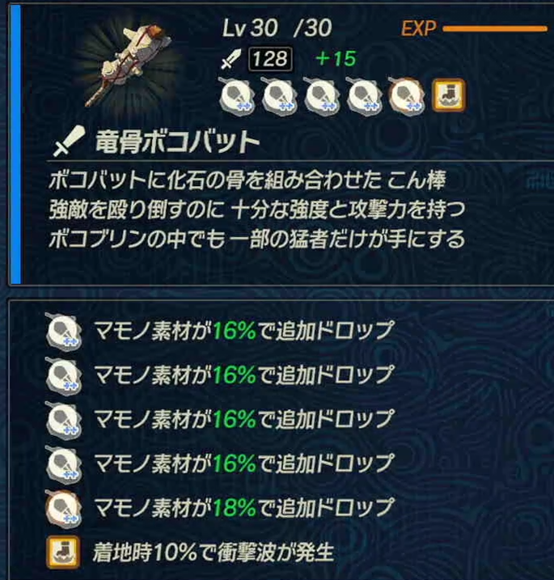

---
2023 03 02 created in Discord (其他遊戲)
2026 10 14 moved from Discord (其他遊戲)
---

薩爾達無雙

## 心得
有水的地方，用"製冰器" 會冰凍敵人!!(很實用!!)
英帕 分別R2三隻小怪 > YYYX，即可滿技能!

## 實用連結
【有雷】心得+全整理-薩爾達無雙災厄啟示錄劇情、攻略、精華
【心得】薩爾達無雙 災厄啟示錄「速刷武器」四個地點推薦
【心得】薩爾達無雙 災厄啟示錄 武器合成22個小知識阿嬤也懂的

## 大全
https://docs.google.com/spreadsheets/d/1OEHcvlydPLU8WCIl-RkcIva25X-FZPXBNrdT0t7Seng/edit#gid=0

## 關卡 >刷素材                                            
露珠的試驗(各屬性的都有!)    > 被奪走的土地 > 蜥蜴    
希多的擊退八爪怪行動(49等) > 八爪怪    
雷之特訓中級(27等) > 蝙蝠    
勇氣之泉(用炸彈炸樹之前，怪會無限重生!) > 莫力布林    
守護者的墳場(60等) > 守護者(八腳機械怪)    
目標是一夜致富！(27等) > 小石頭人

*一些小素材(ex鎧甲鯉魚) 按R1 在 任務選單裡面 一個一個找 就有了!

## 刷錢
難度調成"簡單"(不影響掉落)
格魯德沙漠爭霸戰 (37等)
*前置任務「追擊依蓋隊」，(操作神獸戰鬥，在沙漠地區)
*找鷹眼商人(瑟基摩)賣(價格2.5倍) (任務多刷幾次 他會隨機出現，用L1的列表找即可)

林克 龍骨莫力布林棍 (雙手劍)
*單格數量上限999個，多的會自動賣掉
*平均4分鐘 15000~20000元

吃料理：
鮮蛋布丁 - 升材料道具的掉落率10%
蛋撻 - 提升材料道具的掉落率15%
草莓可麗餅 - 提升材料道具的掉落率20%

打法：跑步時，按X (就這樣!)
(中間出的小王不用打，等尾王出來再用大秒就好)

## 攻擊力最高武器 掉落地點
怨念的漩渦(80等)
*最高攻擊力(74)
*遊戲難度不影響掉落率

## 克洛洛果實位置
https://forum.gamer.com.tw/C.php?bsn=1689&snA=9932

https://www.hk01.com/%E9%81%8A%E6%88%B2%E5%8B%95%E6%BC%AB/554111/%E8%96%A9%E7%88%BE%E9%81%94%E7%84%A1%E9%9B%99-%E7%81%BD%E5%8E%84%E5%95%9F%E7%A4%BA%E9%8C%84%E6%94%BB%E7%95%A5-%E5%85%8B%E6%B4%9B%E6%A0%BC%E7%9A%84%E6%9E%9C%E5%AF%A6%E5%85%A8160%E5%8F%96%E5%BE%97%E4%BD%8D%E7%BD%AE-%E4%B8%8A%E7%AF%87#media_id=5780868
