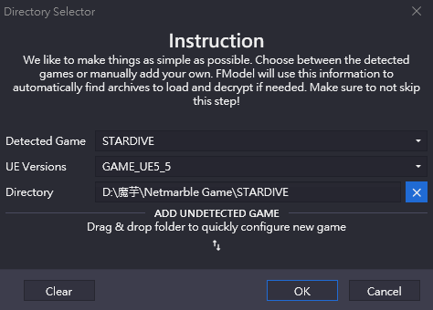
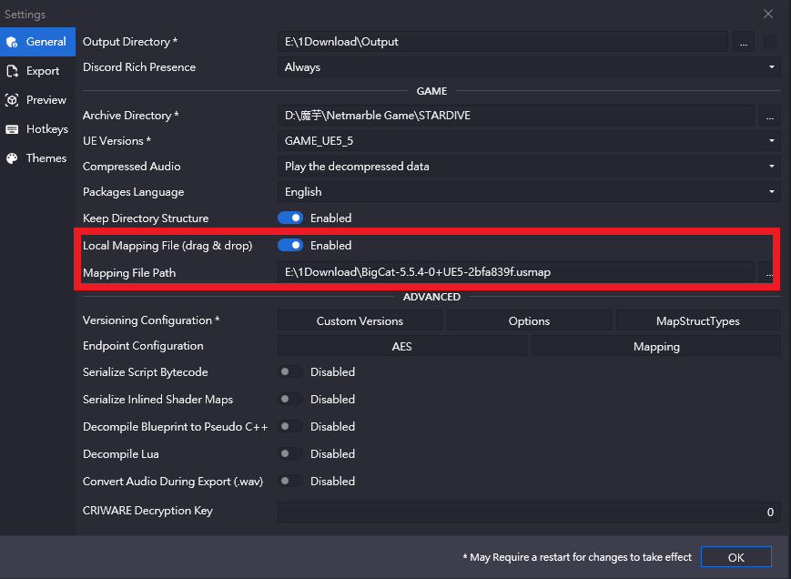
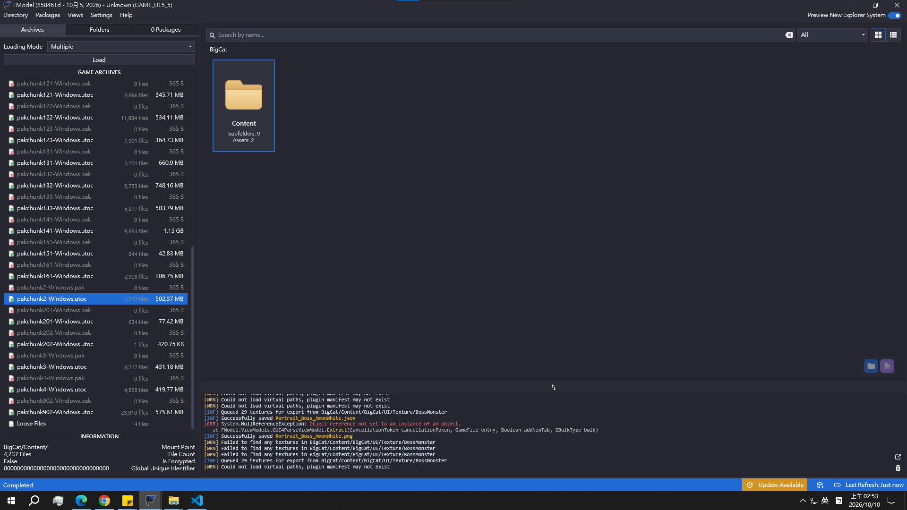

---
2026 10 09 created
---

## 一、準備工具
1.下載拆包用的軟體 FModel
https://fmodel.app/

2.下載開啟 解包檔案 用的檔案，在 FModel discord 有人提供的
FModel discord
https://discord.com/invite/fmodel
檔案
https://discord.com/channels/637265123144237061/1491337570108440668/1546893610598006824

## 二、開啟FModel & 設定
1.開啟 `FModel`
第三個選 `遊戲根目錄\Netmarble Game\STARDIVE`，選完第一個會自己跳名稱(不理他)
第二個選 `GAME_UE5_5` (代表是虛幻引擎5.5版本) 
按OK

2.跳出一堆檔案後，Settings > Local Mapping File (drag & drop) > 選 剛剛2.載的檔案 > 按ok

## 三、查詢 & 輸出資料
1.左手邊一堆 pakchunk編號-Windows.utoc 每一個都只能獨立進入+查詢
所有的資料結構都相同，只是拆成一堆 200~1000MB 的檔案群，每一群都負責某部分的檔案。
拆包的重點在2D圖像，剛好集中在編號個位數 (pakchunk2、pakchunk3、pakchunk4)
然後位置都相同 `Content\BigCat\Content\BigCat\UI\Texture`
所以直接點進去找就好

2.對要下載的檔案or資料夾 右鍵 > Export Folder > Textures，這時候只是把檔案駐列，要點 Views > Export Session > Export 才會下載到指定地點

搜尋技巧：
在 Folders 按 Ctrl+Shift+F 搜尋指定名稱 例如幻獸環就搜尋 icon_monsterling
反覆的在 Archives 點選不同資料後，搜尋 icon_monsterling，有就有，沒有就直接點其他的
