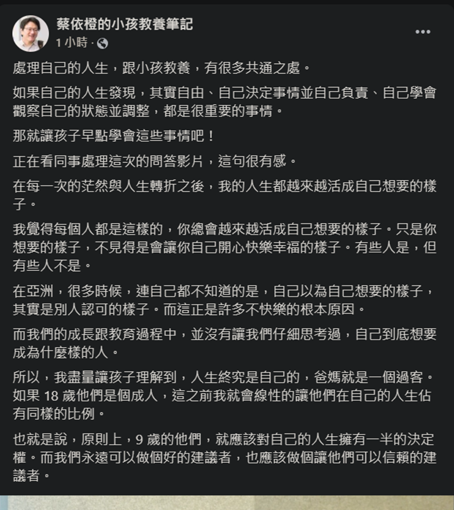

---
2023 08 07 created in Discord (其他遊戲)
2026 10 14 moved from Discord (其他遊戲)
---

2022 02 21 蔡依橙的小孩教養筆記

處理自己的人生，跟小孩教養，有很多共通之處。
如果自己的人生發現，其實自由、自己決定事情並自己負責、自己學會觀察自己的狀態並調整，都是很重要的事情。
那就讓孩子早點學會這些事情吧！
正在看同事處理這次的問答影片，這句很有感。
在每一次的茫然與人生轉折之後，我的人生都越來越活成自己想要的樣子。
我覺得每個人都是這樣的，你總會越來越活成自己想要的樣子。只是你想要的樣子，不見得是會讓你自己開心快樂幸福的樣子。有些人是，但有些人不是。
在亞洲，很多時候，連自己都不知道的是，自己以為自己想要的樣子，其實是別人認可的樣子。而這正是許多不快樂的根本原因。
而我們的成長跟教育過程中，並沒有讓我們仔細思考過，自己到底想要成為什麼樣的人。
所以，我盡量讓孩子理解到，人生終究是自己的，爸媽就是一個過客。如果 18 歲他們是個成人，這之前我就會線性的讓他們在自己的人生佔有同樣的比例。
也就是說，原則上，9 歲的他們，就應該對自己的人生擁有一半的決定權。而我們永遠可以做個好的建議者，也應該做個讓他們可以信賴的建議者。

