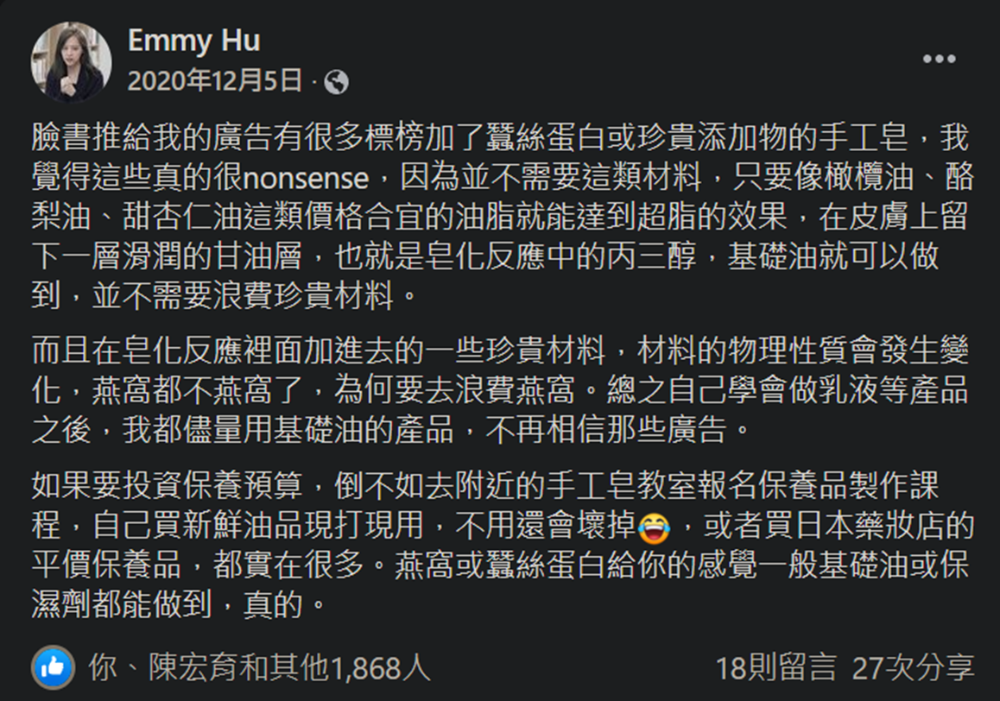

---
2023 08 07 created in Discord (其他遊戲)
2026 10 14 moved from Discord (其他遊戲)
---

護膚相關

臉書推給我的廣告有很多標榜加了蠶絲蛋白或珍貴添加物的手工皂，我覺得這些真的很nonsense，
因為並不需要這類材料，只要像橄欖油、酪梨油、甜杏仁油這類價格合宜的油脂就能達到超脂的效果，
在皮膚上留下一層滑潤的甘油層，也就是皂化反應中的丙三醇，基礎油就可以做到，並不需要浪費珍貴材料。

而且在皂化反應裡面加進去的一些珍貴材料，材料的物理性質會發生變化，燕窩都不燕窩了，
為何要去浪費燕窩。總之自己學會做乳液等產品之後，我都儘量用基礎油的產品，不再相信那些廣告。

如果要投資保養預算，倒不如去附近的手工皂教室報名保養品製作課程，自己買新鮮油品現打現用，不用還會壞掉，
或者買日本藥妝店的平價保養品，都實在很多。燕窩或蠶絲蛋白給你的感覺一般基礎油或保濕劑都能做到，真的。

