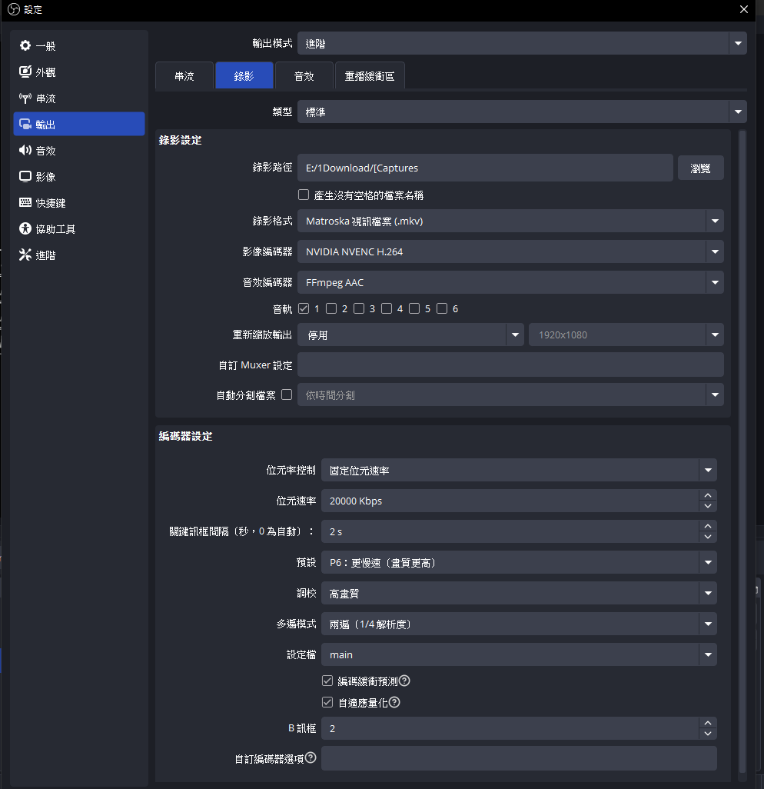
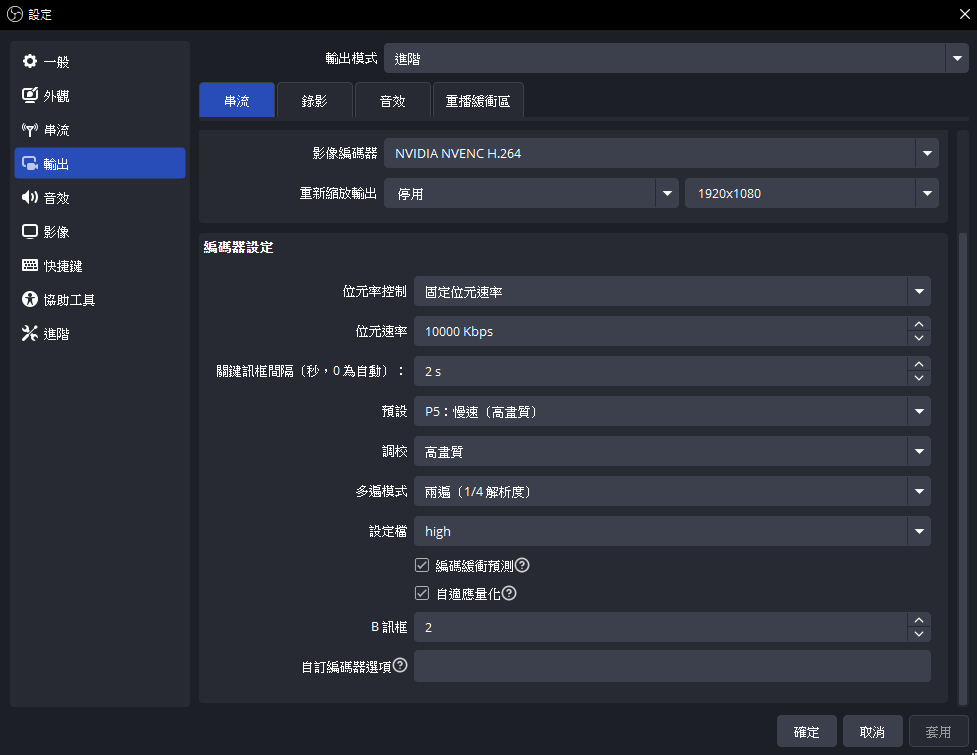
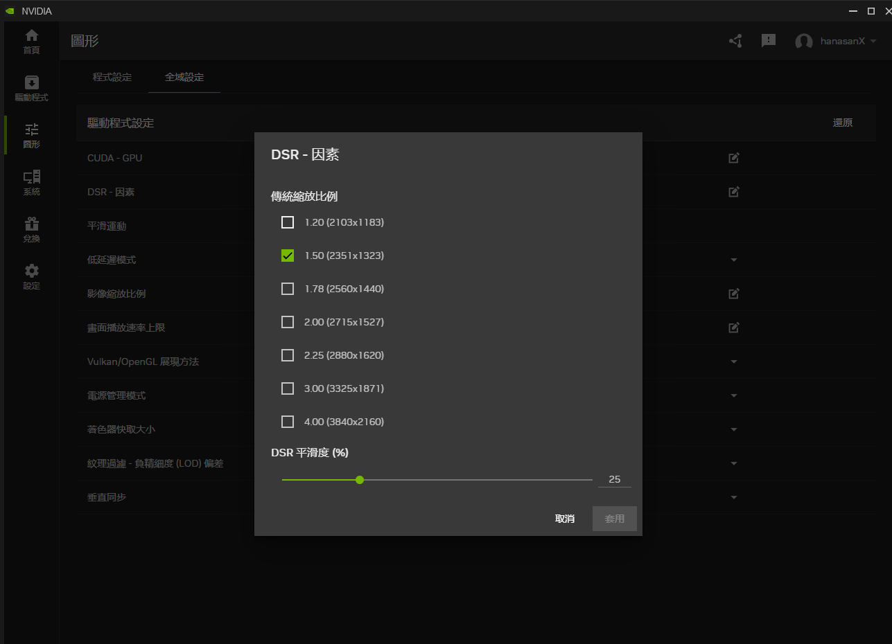
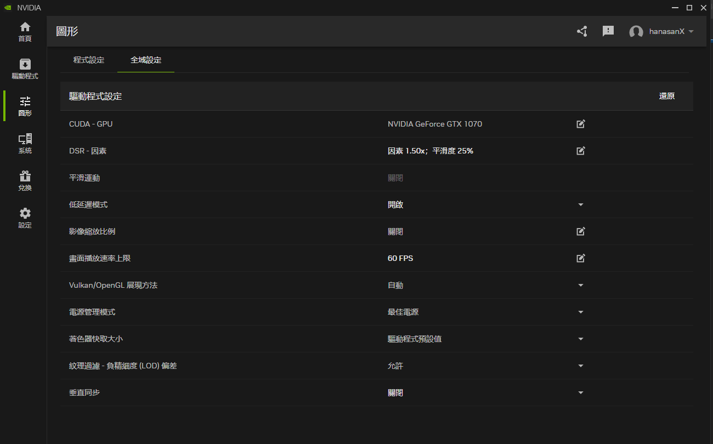

---
2025 05 01 created in OneNote
2026 10 13 moved from OneNote
---

說明:
影像編碼器: 
使用 NVIDIA NVENC H.264 是因為相容性佳
要用 NVIDIA NVENC H.264 或 NVIDIA NVENC HEVC，因為是用GPU運算的，畫質佳 省效能!
不要用AAOM AV1、SVT-AV1、x264，因為是用CPU運算的，畫面卡卡的是正常

設定:
開啟OBS > 設定
錄影設定

串流設定 (直播)

NVIDIA支援用少少的效能，讓畫質更好
原理: x1.33 或 x4.00 就是把畫面以 原解析度的 1.33 / 4.00 倍來渲染後，再縮放回 原本的畫面顯示
把 2k / 4k 的畫面，放到 1k 的螢幕去顯示，得到更精緻的畫面

可勾選多個項目，但系統只會挑一個執行

DSR平滑度 0 ~ 100 鋸齒 ~ 柔化
30~40是擇中的選擇

