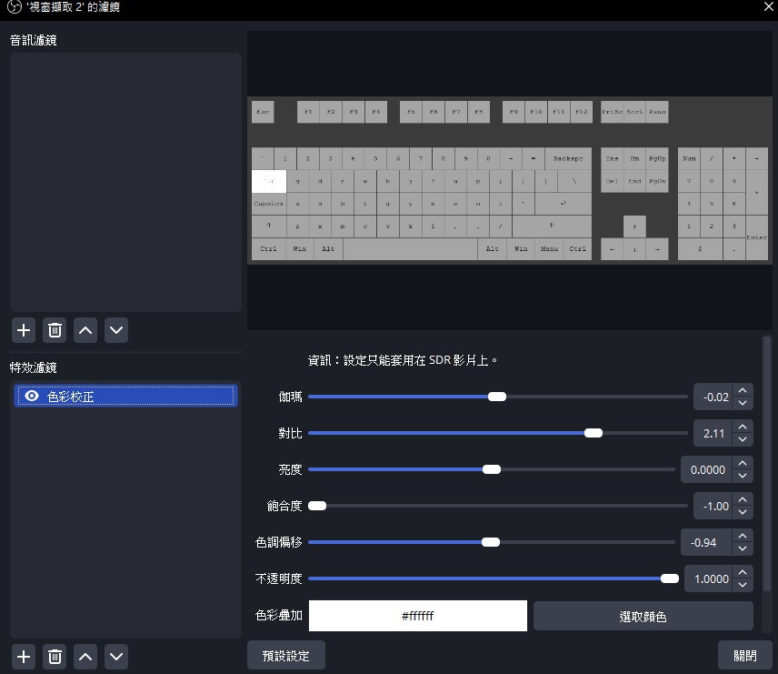

---
2025 03 05 created in OneNote
2026 10 13 moved from OneNote
---

#OBS #錄影 #抓滑鼠 #抓鍵盤 #GW2

1.到網站，下載兩個東西，windows-64bit(主檔案)、nput-overlay-5.0.5-presets.zip(各樣式組合包)
https://github.com/univrsal/input-overlay/releases/tag/v5.0.5

2.把 windows-64bit(主檔案) 安裝在任一地方

3.開啟OBS錄影程式 > 工具 > Input-overlay設定 > 確定

4.解壓縮 nput-overlay-5.0.5-presets.zip (各樣式組合包) 在任一地方

5.在 來源 > 加入來源 > 按鍵輸入嵌入介面 >去前一步 解壓縮好的地方 挑自己要的樣子套用 (兩個選項都選同一個資料夾裡的東西即可)

補充：小貓軟體 (解壓縮後，把裡面的檔案手動貼到 OBS根目錄 覆蓋即可)
https://obsproject.com/forum/resources/bongobs-cat-plugin.992/

## 其他小鍵盤(陽春版)
1.下載 NoahBoard 鍵盤 (獨立檔案)，自己創資料夾後，解壓縮至此 https://github.com/ThoNohT/NohBoard/releases 
2.下載 NoahBoard 鍵盤 的 好看樣式，在自己創的資料夾，解壓縮至此，把檔案覆蓋 https://www.dropbox.com/sh/a7y1cokms99dzqc/AABydRunMwzQSQ4R9A_tjfXta/keyboards?dl=0 來源 https://www.youtube.com/watch?v=LXmwDT2yfwk

步驟
1.開啟 NoahBoard 鍵盤，右鍵 > Load Keyboard > Input Overlay > Input overlay style > Close

2.開啟 OBS錄影程式，+ > 視窗擷取 > 選 NoahBoard 鍵盤 > 自己調好大小&位置即可

GW2用多開模擬器會抓不到 按鍵，直接開啟 GW2 才抓的到

補充
把藍藍的鍵盤弄成灰黑色的
1.下載+安裝 obs-chroma-key-tools
https://github.com/exeldro/obs-shaderfilter/releases/tag/2.3.2

2.在OBS內 點選要變灰的視窗 > 濾鏡 > 左下角的 + > 色彩校正
調成以下設定即可

